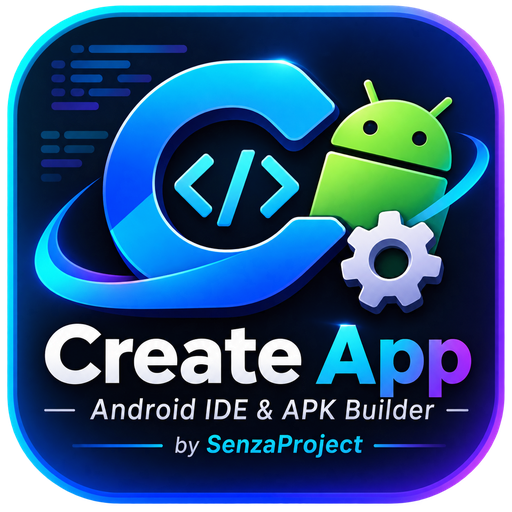

<p align="center">
  
</p>

<h1 align="center">Create App</h1>

<p align="center">
  Android IDE &amp; APK Builder — dikembangkan oleh <b>SenzaProject</b>
</p>

> **Status: Tahap 3 (Project Manager dan File Explorer) — kode dan unit test ditulis, menunggu CI dan uji di perangkat.**
> Proyek ini sedang dibangun bertahap. Hanya fitur yang tercantum sebagai **Tersedia** di bawah
> yang sudah ada; sisanya direncanakan dan tidak boleh dianggap berfungsi.

## Deskripsi

Create App bertujuan menjadi IDE Android yang berjalan langsung di smartphone: membuat dan
mengedit proyek, menjalankan build Gradle sungguhan, menghasilkan APK, dan mengelola Git/GitHub.
Pendekatan build bersifat **hibrid**: lokal melalui Termux dan cloud melalui GitHub Actions.

## Fitur dan status

| Fitur | Status | Tahap roadmap |
|---|---|---|
| Struktur proyek modular, navigasi, tema gelap/terang | Tersedia (belum terverifikasi di perangkat) | 1 |
| Logging ke file, penyamaran rahasia, laporan crash | Tersedia (belum terverifikasi di perangkat) | 1 |
| CI GitHub Actions (unit test + APK debug) | Tersedia (belum dijalankan) | 1 |
| Splash, Dashboard, navigasi, tampilan Project Manager | Tersedia (belum terverifikasi di perangkat) | 2 |
| Editor awal (buffer sementara, nomor baris, posisi kursor) | Tersedia (belum terverifikasi di perangkat) | 2 |
| Buat/ganti nama/hapus proyek, buka folder (SAF), File Explorer, buat/ganti nama/hapus file, simpan file | Ditulis, **belum dikompilasi/diuji** | 3 |
| Code Editor lengkap (highlighting, undo, multi-tab) | Belum | 4 |
| Terminal dan integrasi Termux | Belum | 5 |
| Build Gradle (debug/release/AAB) | Belum | 6 |
| APK Manager | Belum | 7 |
| Signing, GitHub, Cloud Build | Belum | 8–10 |
| Error Analyzer, Preview, Settings lengkap | Belum | 11–13 |

Detail lengkap: [`docs/ROADMAP.md`](docs/ROADMAP.md), [`docs/CHECKLIST.md`](docs/CHECKLIST.md), laporan tahap: [`docs/TAHAP-1.md`](docs/TAHAP-1.md), [`docs/TAHAP-2.md`](docs/TAHAP-2.md), [`docs/TAHAP-3.md`](docs/TAHAP-3.md).

## Screenshots

Belum ada screenshot aplikasi. Mockup desain UI tersedia di [`docs/design/`](docs/design/)
(ini rancangan, **bukan** tampilan aplikasi saat ini).

## Persyaratan

- Perangkat Android 8.0 (API 26) atau lebih baru.
- Untuk build: JDK 17, Android SDK (platform 35), Gradle 8.13 — atau cukup GitHub Actions.

## Instalasi

1. Buka tab **Actions** di repository, pilih run terbaru yang berhasil.
2. Unduh artifact **CreateApp-debug-apk**, ekstrak, lalu pasang `app-debug.apk`.
3. Izinkan instalasi dari sumber tidak dikenal bila diminta.

## Cara build

### Opsi A — GitHub Actions (disarankan, tanpa SDK di HP)

Push ke GitHub; workflow `.github/workflows/android.yml` menjalankan unit test dan membuat APK debug.
Panduan push dari Termux: [`docs/TERMUX-PUSH.md`](docs/TERMUX-PUSH.md).

### Opsi B — Lokal (Termux atau PC)

```sh
sh scripts/check-env.sh        # periksa JDK, SDK, Gradle
sh scripts/setup-wrapper.sh    # sekali saja: buat gradlew + gradle-wrapper.jar
./gradlew test
./gradlew :app:assembleDebug
# hasil: app/build/outputs/apk/debug/app-debug.apk
```

Build lokal di Android memiliki keterbatasan (arsitektur binary SDK, memori). Lihat
[Keterbatasan](#keterbatasan-yang-diketahui).

## Arsitektur

Clean Architecture + MVVM + Repository, multi-modul, dengan dependency injection manual.
Ringkasan dan aturan dependensi: [`docs/ARCHITECTURE.md`](docs/ARCHITECTURE.md).

```
app/            Presentation: Compose UI, navigasi, DI
domain/         Model, kontrak repository, use case (Kotlin murni)
data/           Implementasi repository
core/common     Logging, dispatcher, crash reporter
core/project    Penyimpanan proyek berbasis folder, operasi file, impor/ekspor SAF (Tahap 3)
core/editor     (metrik teks editor awal; fitur penuh Tahap 4)
core/terminal   (direncanakan, Tahap 5)
core/builder    (direncanakan, Tahap 6)
core/git        (direncanakan, Tahap 9)
```

## GitHub Actions

Workflow `android.yml` berjalan pada `push`, `pull_request`, dan manual. Langkah: JDK 17 → Android SDK →
Gradle → siapkan wrapper → `./gradlew test` → `./gradlew :app:assembleDebug` → upload APK.
Keystore dan rahasia **tidak** disimpan di repository; signing release lewat GitHub Secrets dikerjakan di Tahap 8.

## Keterbatasan yang diketahui

- Tahap 1 belum diverifikasi di perangkat; lihat [`docs/TAHAP-1.md`](docs/TAHAP-1.md).
- Gradle Wrapper dibuat oleh `scripts/setup-wrapper.sh` (atau otomatis oleh CI), belum ikut di repository.
- Tahap 3 belum pernah dikompilasi atau dijalankan; lihat [`docs/TAHAP-3.md`](docs/TAHAP-3.md) untuk status verifikasi yang jujur.
- Belum ada simpan otomatis: perubahan file yang belum disimpan hilang bila aplikasi ditutup (Tahap 4). Buffer sementara dari Beranda tidak disimpan ke file.
- Template proyek Android hanya kerangka Gradle; kemampuannya dibangun baru diuji pada Tahap 6.
- Layar Build, GitHub, dan Terminal masih berupa penanda "belum tersedia".
- Build lokal di HP bergantung pada Termux, JDK, dan SDK yang kompatibel; belum diuji.

## Roadmap

1.0: Project Manager, Code Editor, File Manager, Build Debug APK, Build Logs, GitHub.
1.1: Release APK, Keystore Manager, Terminal, Dependency Manager, Build History.
1.2: Code Completion, Error Analyzer, XML Preview, Project Templates.
2.0: AI Coding Assistant, Remote Build, Advanced Debugging, Plugin System.

## Kredit

Pengembang: **SenzaProject** — https://github.com/SenzaProject/CreateApp
